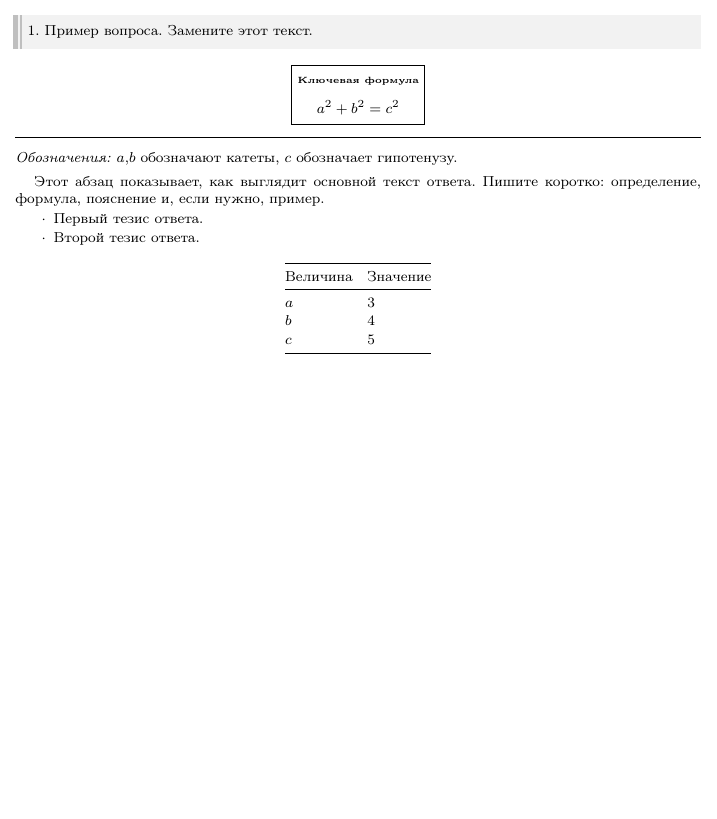

# Шаблон шпаргалки на LaTeX

Компактная шпаргалка на pdfLaTeX: страница 14 × 16 см, 8 pt, один вопрос на страницу, серая плашка заголовка, оглавление и печать 3 × 4 на A4.

Вся вёрстка, пакеты и макросы вынесены в `cheatsheet.sty`. В `main.tex` остались только метаданные и содержание.



## Файлы

| Файл | Назначение |
| --- | --- |
| `main.tex` | Метаданные, вопросы и ответы |
| `cheatsheet.sty` | Страница, пакеты, блоки, математические макросы |
| `collage.tex` | Раскладка 3 × 4 на A4 для печати |
| `AGENTS.md` | Правила оформления для пользователя и AI-агента |
| `.github/workflows/build.yml` | Сборка `main.pdf` и `collage.pdf` в GitHub Actions |
| `preview.png` | Пример страницы с вопросом |

## Быстрый старт

1. Откройте `main.tex` и замените `\title`, `\author` и вступительный текст.
2. Удалите пример вопроса и добавьте свои.
3. Соберите PDF:

```bash
latexmk -pdf main.tex
```

4. Для печати соберите коллаж:

```bash
latexmk -pdf collage.tex
```

Файлы появятся в корне: `main.pdf` и `collage.pdf`.

## Как добавить вопрос

Каждый вопрос оформляется макросом `\tquastion`:

```latex
\tquastion{2. Название следующего вопроса.}

\[\boxed{\begin{gathered}
  \text{\scriptsize\textbf{Ключевая формула}}\\[3pt]
  ...
\end{gathered}}\]

\noindent\rule{\linewidth}{0.4pt}\par\smallskip
\noindent\textit{Обозначения:} ...\par\smallskip

Основной текст ответа.
```

`\tquastion` уже делает три вещи:

- начинает новую страницу;
- добавляет вопрос в оглавление;
- выводит серую плашку `librarybox`.

Не дублируйте заголовок через `\section`: в оглавлении появится лишняя запись.

## Что уже есть в стиле

`cheatsheet.sty` подключает русский язык, математику, таблицы, графику, ссылки и блоки. Не подключайте эти пакеты повторно в `main.tex`.

Доступны:

- `\tquastion{...}` для вопросов;
- `librarybox` для плашки заголовка;
- `\boxed{\begin{gathered}...\end{gathered}}` для ключевых формул;
- `\pp`, `\dd`, `\ppp`, `\ddd`, `\dif` для производных;
- `L{...}` и `C{...}` для таблиц;
- `\appendixsection{...}` для приложений;
- `\cref{...}` для ссылок.

Подробные правила и шаблоны лежат в `AGENTS.md`.

## Печать

`collage.tex` берёт страницы из `main.pdf` и раскладывает их по 12 штук на A4:

```latex
pages=2-last,
nup=3x4,
frame=true,
scale=0.4285714285714286
```

`pages=2-last` пропускает титульный лист с оглавлением. Если структура изменилась, поправьте номер первой страницы.

`scale=0.4285714285714286` соответствует странице 14 × 16 см. Если меняете формат, пересчитайте масштаб.

## GitHub Actions

Workflow `.github/workflows/build.yml` собирает `main.pdf` и `collage.pdf` и загружает оба файла в артефакт `cheat-sheet-pdf`.

Скачать PDF: вкладка **Actions**, последний запуск, блок **Artifacts**.

Чтобы появилась кнопка **Use this template**, включите **Settings → General → Template repository**.

## Требования

- pdfLaTeX из TeX Live 2025 или новее. Проверено на TeX Live 2025.
- Пакеты, перечисленные в `cheatsheet.sty`. В полной установке TeX Live они уже есть.
- `latexmk` для сборки.
